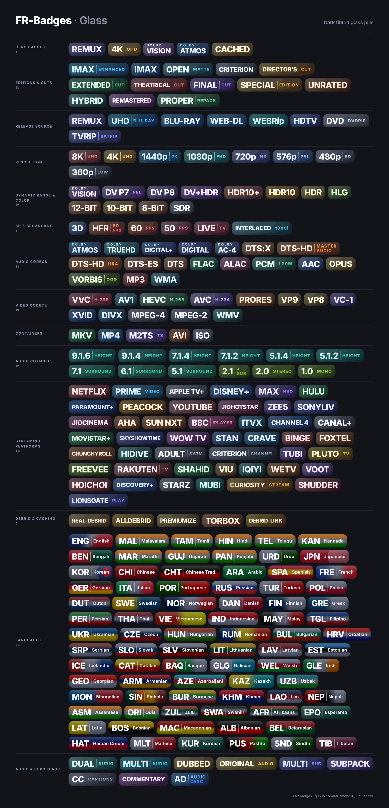

# FR-Badges

Modern badge pack for media tags: **source, resolution, HDR, codec, bit depth and audio**. 31 badges in 6 styles, all transparent PNGs, with ready-to-use filter manifests.



## Styles

| Style | Look | Folder | Manifest |
|---|---|---|---|
| **Glass** | Dark tinted glass pills | `Badges` | `badges.json` |
| **Solid** | Vivid gradient fills | `Badges-Solid` | `badges-solid.json` |
| **Neon** | Glowing gradient text, no background (dark UIs) | `Badges-Neon` | `badges-neon.json` |
| **Light** | Soft pastel pills (light UIs) | `Badges-Light` | `badges-light.json` |
| **Icon Dark** | Gradient icon tiles on dark glass | `Badges-Icon-Dark` | `badges-icon-dark.json` |
| **Icon Light** | Gradient icon tiles on pastel | `Badges-Icon-Light` | `badges-icon-light.json` |

Previews: [Glass](Previews/preview-glass.png) · [Solid](Previews/preview-solid.png) · [Neon](Previews/preview-neon.png) · [Light](Previews/preview-light.png) · [Icon Dark](Previews/preview-icon-dark.png) · [Icon Light](Previews/preview-icon-light.png)

## What's included

| Group | Badges |
|---|---|
| Source | REMUX, Blu-ray, WEB-DL, WEBRip, HDTV, DVD Rip |
| Resolution | 4K, 1080p, 720p, 480p |
| Video Tech | Dolby Vision, HDR10+, HDR10, HDR, SDR, IMAX Enhanced, IMAX |
| Video Codec | HEVC, AVC |
| Bit Depth | 10-bit, 8-bit |
| Audio Tech | Atmos, TrueHD, Dolby Digital+, Dolby Digital, DTS:X, DTS-HD MA, DTS-HD, DTS |
| Audio Channels | 7.1, 5.1 |

## Usage

Import a manifest by its raw URL. Pick one style:

```
https://raw.githubusercontent.com/farizmohd70/FR-Badges/main/badges.json
https://raw.githubusercontent.com/farizmohd70/FR-Badges/main/badges-solid.json
https://raw.githubusercontent.com/farizmohd70/FR-Badges/main/badges-neon.json
https://raw.githubusercontent.com/farizmohd70/FR-Badges/main/badges-light.json
https://raw.githubusercontent.com/farizmohd70/FR-Badges/main/badges-icon-dark.json
https://raw.githubusercontent.com/farizmohd70/FR-Badges/main/badges-icon-light.json
```

Each manifest holds the filename patterns and image links for that style. If the app caches images, clear its cache after switching styles.

## Notes

- Badges are original designs with plain-text labels. They are not the official logos of Dolby, DTS, IMAX, Blu-ray Disc or others.
- Every badge has a transparent margin, so rounded edges don't get clipped when an app crops to the image bounds.
- Based on the original [Elite-Badges](https://github.com/leonevz/Elite-Badges) manifest structure.
